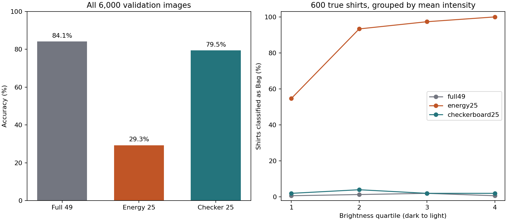
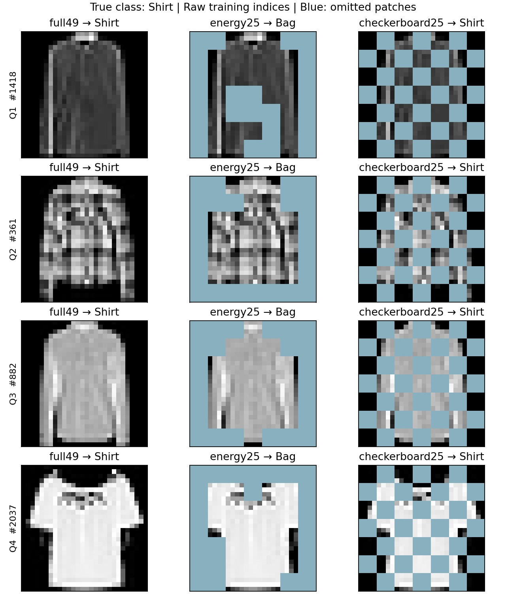

# 成员一 · 选块后的误判集中在哪里？

在同一组权重、同一批 6,000 张验证图上，能量 25 块让 3,353 张原先答对的图变成错判。其中 **2,934 张（87.50%）转为「包」**。同样保留 25 块，改用覆盖图像四周和中心的棋盘格后，新增错误中有 48/464 张（10.34%）转为包。选块布局对这组权重的分类结果有明显影响。

## 同一张图前后的变化

| 输入 | 正确 / 6,000 | 准确率 | 完整输入答对 → 答错 | 完整输入答错 → 答对 | 非包误判为包 / 5,400 |
|---|---:|---:|---:|---:|---:|
| 完整 49 块 | 5,048 | 84.13% | — | — | 35（0.65%） |
| 能量 25 块 | 1,757 | 29.28% | 3,353 | 62 | 3,730（69.07%） |
| 棋盘格 25 块 | 4,768 | 79.47% | 464 | 184 | 99（1.83%） |

三列计数回答不同问题。新增错误只可能来自完整输入答对的 5,048 张，改正只可能来自原先答错的 952 张。「非包误判为包」统计全部 5,400 张真实类别为非包的图片，包括完整输入已答错的图片。各类别各有 600 张，能量策略将其中 574 张外套、575 张短靴和 518 张衬衫判成包。十类完整计数见 [per_class.csv](per_class.csv)。

## 亮色衬衫更容易被判成包吗？

对全部 600 张真实类别为 Shirt 的衬衫，计算每张原图全部 784 个像素的平均灰度，包含背景，量纲为 0 到 255。按这 600 个数的第 25、50 和 75 百分位分组，切点约为 59.379、87.370 和 112.040，等于切点的图归入较暗一组。每格的分母都是本组 **150 张真衬衫**。

| 按原图亮度分组 | 完整 49 块判为包 | 能量 25 块判为包 | 棋盘格 25 块判为包 |
|---|---:|---:|---:|
| Q1（最暗） | 1/150 | 82/150（54.67%） | 3/150 |
| Q2 | 2/150 | 140/150（93.33%） | 6/150 |
| Q3 | 3/150 | 146/150（97.33%） | 3/150 |
| Q4（最亮） | 1/150 | 150/150（100%） | 3/150 |

能量规则下，误判为包的比例随全图平均灰度上升。棋盘格下该比例维持在 2%～4%。全图平均值同时受前景面积和服饰颜色影响，这项观察无法区分二者的作用。[完整分箱数据](shirt_quartiles.csv)

## 回看原图和输入掩码

下图每行对应一张真衬衫。从左至右为完整输入、能量 25 块、棋盘格 25 块。蓝色区域表示推理时省略的图块。为展示同图差异，只在「完整正确、能量误包、棋盘格正确」的子集中选样，每个亮度组取官方训练集下标最小的一张。四组满足这一条件的候选数依次为 48、72、73 和 56。用上表估计整体发生率，用下图观察错误发生时各布局保留了哪些位置。[示例下标](example_indices.csv)

## 复核和重跑

从仓库根目录执行 `python -m team_experiments.diagnosis`。程序严格装载 `results/best.ckpt`，按 `results/split.npz` 的验证下标读取官方训练数据，只在验证集做推理。所有选块使用原图位置编码。能量规则按块内归一化像素平方和排名，棋盘格保留 7×7 网格中行列坐标之和为偶数的 25 块。

[每图预测](validation_predictions.csv) 中 `raw_train_index` 是从零开始的官方训练集下标，`val_row` 是从零开始的验证集行号，三列预测和真实标签均使用 Fashion-MNIST 的 0～9 类别编号。`shirt_quartile` 仅对真实衬衫有值。[总体计数](summary.csv) 中 `new_errors_to_bag` 是新增错误的子集，`false_bag` 指所有非包图片中的误包数。
