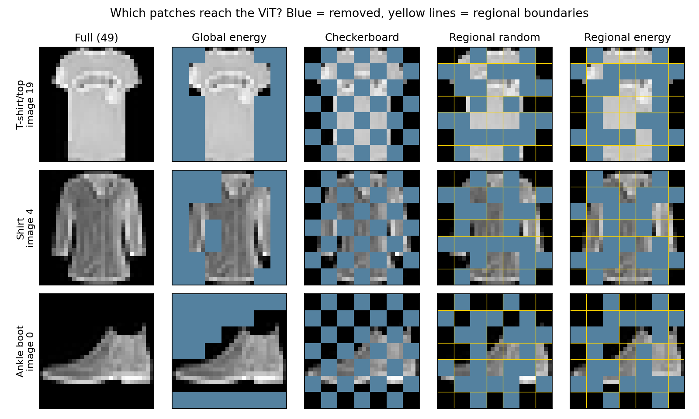

# 成员二 · 同为 25 个图块，怎样选择位置？

在同一套完整输入训练得到的 ViT 权重上，棋盘交错保留 25 块的验证准确率最高，达到 79.47%。按预定规则选中棋盘后，官方测试集上答对 7,870 / 10,000 张。完整 49 块答对 8,375 张。

## 算法与对照

每张 28×28 的图切成 7×7 个图块。横轴和纵轴都按宽度 `1 / 2 / 1 / 2 / 1` 划分，得到 25 个大小不同的矩形区。每区选一块，各图恰好保留 25 块。区域随机在每区均匀选择，区域能量取每区像素平方和最大者，并列时取原图编号最小者。所有输入图块使用原始位置编号升序排列。程序检查每区恰好一块、编号顺序、输入图块与编号一致、全零图的并列处理及变换批量切分后的随机结果一致性。

棋盘保留行号与列号之和为偶数的 25 个位置，中心保留内侧 5×5 块，全局随机在 49 块中无放回抽取 25 块，全局能量保留能量最高的 25 块。这些方案共享同一检查点、数据样本与位置编码。完整输入作为参照。

## 选择规则和结果

使用仓库原始 `results/best.ckpt` 和 `results/split.npz`，对验证集每类 600 张、共 6,000 张评估。先按验证准确率、再按验证宏平均 F1 降序排列所有 25 块方法，仍有并列则按方法英文名升序取首项。程序先保存规则和权重摘要，写出全部验证结果与胜者，再读取官方测试集图像和标签，报告所有预设对照。

| 选块方案 | 验证准确率 | 验证宏 F1 | 测试准确率 | 测试宏 F1 |
|---|---:|---:|---:|---:|
| 完整 49 块 | 84.13% | 0.8412 | 83.75% | 0.8375 |
| 棋盘 25 块 | 79.47% | 0.7957 | 78.70% | 0.7882 |
| 全局随机 25 块 | 69.04% | 0.6883 | 68.91% | 0.6876 |
| 区域随机 25 块 | 65.66% | 0.6550 | 65.82% | 0.6575 |
| 区域能量 25 块 | 57.90% | 0.5653 | 58.18% | 0.5683 |
| 中心 25 块 | 56.55% | 0.5210 | 56.16% | 0.5170 |
| 全局能量 25 块 | 29.28% | 0.2728 | 29.69% | 0.2753 |

随机方案分别用 17、29、43 三个掩码种子评估。每个种子都在完整划分上计算准确率和 10 类等权的宏平均 F1，再取三个种子的算术均值。汇总 CSV 的 `_sd` 是各随机种子的样本标准差，确定性方案仅测一次。每次运行的种子、样本数和正确张数见明细 CSV。

强制区域覆盖让能量方案的测试准确率提高了 28.49 个百分点，但区域随机比全局随机低 3.09 个百分点。区域面积不同而每区配额相同，例如某个区只含一个图块时该位置必选。这里观察到的变化同时包含空间覆盖与位置抽取概率的变化。棋盘相对完整输入少用 24 个图块，准确率少 5.05 个百分点。同图对照发现，805 张原先答对的图在棋盘输入下答错，另有 300 张原先答错的图在棋盘输入下答对。



## 复现与核对

在仓库根目录、安装了仓库依赖的 Python 环境中执行：

```shell
python -m team_experiments.selection
```

`protocol.json` 保存预设条件、版本、权重和划分文件的 SHA-256。`selection.json` 保存验证集选出的方案。`validation_summary.csv`、`test_summary.csv` 是策略汇总，同名前缀的 `*_runs.csv` 记录每个种子。`*_predictions.npz` 包含原编号 `indices`、标签 `actual` 和各方法逐图预测。本机复测的完整、中心、全局能量及三个全局随机种子的测试预测均与仓库中相应的逐图记录一致。
