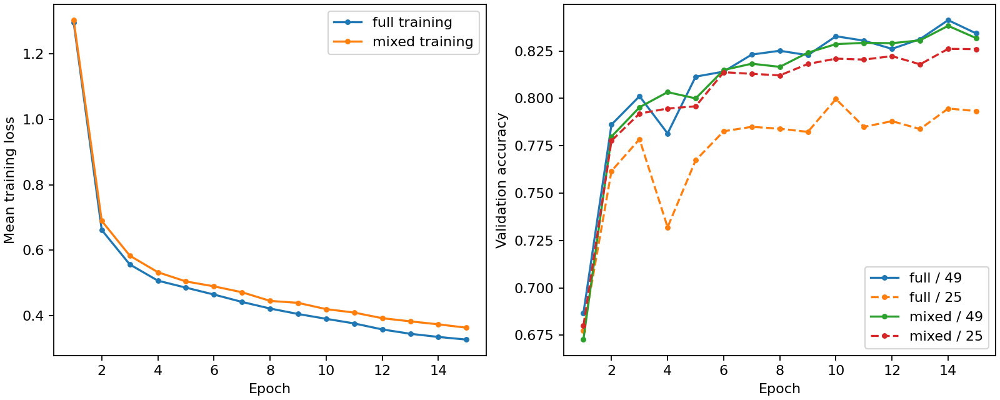

# 成员三 · 训练时交替输入能否降低棋盘剪枝的精度损失？

比较两种训练方式。完整输入组每次更新使用全部 49 个图像块。混合输入组按批交替使用 49 块与棋盘保留的 25 块。棋盘取 7×7 网格上行列坐标之和为偶数的位置，并沿用原始位置编码。两组各自选出一个最佳检查点，再分别使用完整输入及棋盘输入评估。

## 本机结果

| 训练方式 | 推理输入 | 验证准确率 | 验证宏平均 F1 | 测试准确率 | 测试宏平均 F1 |
|---|---|---:|---:|---:|---:|
| 完整 | 完整 49 块 | 84.13% | 0.8412 | 83.75% | 0.8375 |
| 完整 | 棋盘 25 块 | 79.47% | 0.7957 | 78.70% | 0.7882 |
| 混合 | 完整 49 块 | 83.83% | 0.8381 | 83.47% | 0.8347 |
| 混合 | 棋盘 25 块 | 82.62% | 0.8260 | 82.58% | 0.8260 |

两组各更新 2,355 步，均在第 14 轮取得最高验证选模分数。完整组使用 2,355 个完整输入批。混合组使用 1,178 个完整输入批和 1,177 个棋盘批。

在相同的 10,000 张测试图上，混合训练使棋盘输入多判对 388 张，准确率提高 3.88 个百分点，完整输入少判对 28 张，下降 0.28 个百分点。从完整输入切换到棋盘输入时，完整训练模型的准确率下降 5.05 个百分点，混合训练模型下降 0.89 个百分点。本次对照使用一个初始化种子，跨种子的收益幅度仍需进一步实验。



## 实验设计

- 使用 Fashion-MNIST 和仓库的 `results/split.npz`。训练集 10,000 张、验证集 6,000 张，官方测试集 10,000 张。训练和验证样本下标互斥。程序在训练前校验原始数据文件的 MD5。
- 两组从同一个 `initial.ckpt` 恢复 FashionViT 参数，各自新建 AdamWeightDecay 优化器，学习率 0.0003，权重衰减 0.01。种子 42，训练 15 轮，批大小 64，MindSpore 2.6.0，CPU 四线程。
- 每轮使用相同的 10,000 张图片和相同的乱序。每轮 156 个完整批加 1 个 16 张的小批，共 157 步。混合组在奇数轮使用 79 个完整输入批、78 个棋盘批，偶数轮对调。两组更新次数一致，混合组处理的图像块总数更少。
- 两种评估输入权重相同。每轮对 6,000 张验证图各评估一次，按两种输入准确率的算术平均值选出最佳轮次，并列时保留较早轮次。全部训练完成后恢复两个最佳检查点，重新核验验证分数，最后评估官方测试集。宏平均 F1 为十个类别 F1 的算术平均。

## 复现与核验

在仓库根目录运行以下 PowerShell 命令。输出使用新目录，省略 `--modes` 会训练两组，指定 `--modes mixed` 可单独训练混合组。

```powershell
.\.venv\Scripts\python.exe -m team_experiments.training --out .\results-rerun-training
```

- `config.json` 保存超参数、划分文件哈希和检查点选择标准。`audit.json` 汇总初始参数哈希、实际更新数、两种输入批数和最佳轮次。
- `history_full.csv` 与 `history_mixed.csv` 逐轮记录损失、两个验证准确率、宏平均 F1、选模分数以及顺序哈希。比对两文件中的 `order_sha256` 可核验两组每轮训练样本及次序相同。
- `initial.ckpt` 是共享初始权重。`best_full.ckpt`、`best_mixed.ckpt` 分别是两组按验证指标选出的权重。`evaluation.csv` 含各组在验证及测试上的完整交叉评估。`learning_curves.png` 展示两条训练损失和四条验证准确率曲线。
