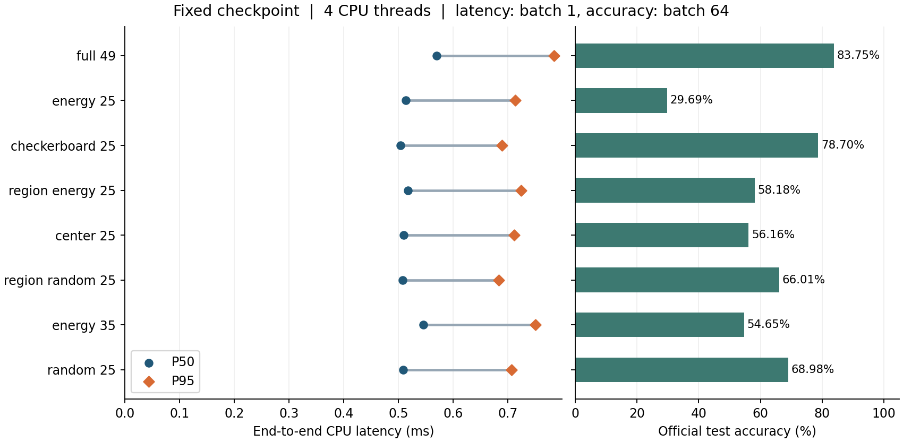

# 成员四 · 少看图块能省下多少 CPU 推理时间？

在本机 Ryzen 7 9800X3D 上，仓库权重的棋盘输入在五轮中均快于完整输入，中位配对加速比为 **1.137×**。再用成员三训练的混合权重单独比较，棋盘输入的测试准确率为 **82.58%**，单图 P50 为 **0.509 ms**，五轮均快于同权重的完整输入。

## 两套权重的实测对照

| 权重 | 输入 | 测试准确率 | 端到端 P50（ms） | 端到端 P95（ms） | 同轮 P50 加速比范围 |
|---|---|---:|---:|---:|---:|
| 仓库基线 | 完整 49 | 83.75% | 0.570 | 0.784 | 1.000× |
| 仓库基线 | 棋盘 25 | 78.70% | 0.503 | 0.689 | 1.069–1.178× |
| 混合训练 | 完整 49 | 83.47% | 0.575 | 0.769 | 1.000× |
| 混合训练 | 棋盘 25 | 82.58% | 0.509 | 0.686 | 1.077–1.163× |

混合权重内，从 49 块减到 25 块少判对 89/10,000 张，五轮中位配对加速比为 1.130×，对应单图中位延迟下降约 11.5%。准备阶段 P50 从 0.035 ms 增至 0.048 ms，推理阶段从 0.528 ms 降至 0.442 ms。端到端、准备、推理三项分别取分位数。实际整条链路的加速幅度小于图块数减少的比例。

基线权重的八种方案各测五轮。混合权重的额外对照只测完整和棋盘两种输入，五轮中交替先后顺序，另外记录 3,000 条单图计时。两个实验各自固定权重，在各自轮内配对。[混合权重的逐轮结果](mixed_pair/rounds.csv) · [混合权重的汇总和准确率](mixed_pair/summary.csv)

## 实验方法

使用同一套仓库权重，比较完整 49 块、能量 35 块，以及六种 25 块方案。每轮开启独立 Python 进程，使用 MindSpore CPU 图模式和 4 个线程。每种方案先在相应的单图输入形状上预热 30 次，随后逐张计时。图像已在内存中。准备耗时包含切块、归一化、选块与张量转换；推理耗时包含模型前向、同步得到输出和取最大分数的类别。

5 轮使用同一批 300 张测试图，图像及顺序由种子 2026 固定。每轮都改变八种方案的起始位置，循环平移量为 0、3、6、1、4。共有 5 × 8 × 300 = 12,000 条计时记录。先对每轮的 300 张计算中位数（P50）和第 95 百分位数（P95），再分别取五轮的中位数。同轮加速比等于该轮完整输入 P50 除以该轮对应方案 P50，取值大于 1 表示该方案更快。

准确率另在全部 10,000 张官方测试图上评估，预测批量为 64，计时批量为 1。这里两种随机方案均固定随机掩码种子 17；成员二的算法研究报告三个掩码种子的均值。随机策略的计时和准确率分别生成掩码，逐图时间用于描述该策略的开销。五轮共用 300 张独立图片，因此轮间范围表示本机重复运行的波动。

## 代码、原始数据与图

- [性能评测入口](../../performance.py) 和 [原项目的单图计时函数](../../../evaluate.py)。
- [逐图计时](timings.csv) 给出轮次、方案执行顺序、官方测试图编号、准备、推理和端到端毫秒数。
- [分轮结果](rounds.csv) 提供 40 组轮内分位数和配对加速比。[汇总表](summary.csv) 提供五轮中位数、加速比范围和快于完整输入的轮数。
- [运行环境](environment.json) 记录软件版本、权重校验值、计时顺序和种子。

从仓库根目录执行 `python -m team_experiments.performance --out results-rerun-team/04_performance` 可在新目录生成全部数据和图。

执行 `python -m team_experiments.performance --mixed-pair --out results-rerun-team/04_performance/mixed_pair` 可重复混合权重的额外对照。通过 `--checkpoint` 可指定刚训练得到的 `best_mixed.ckpt`。
